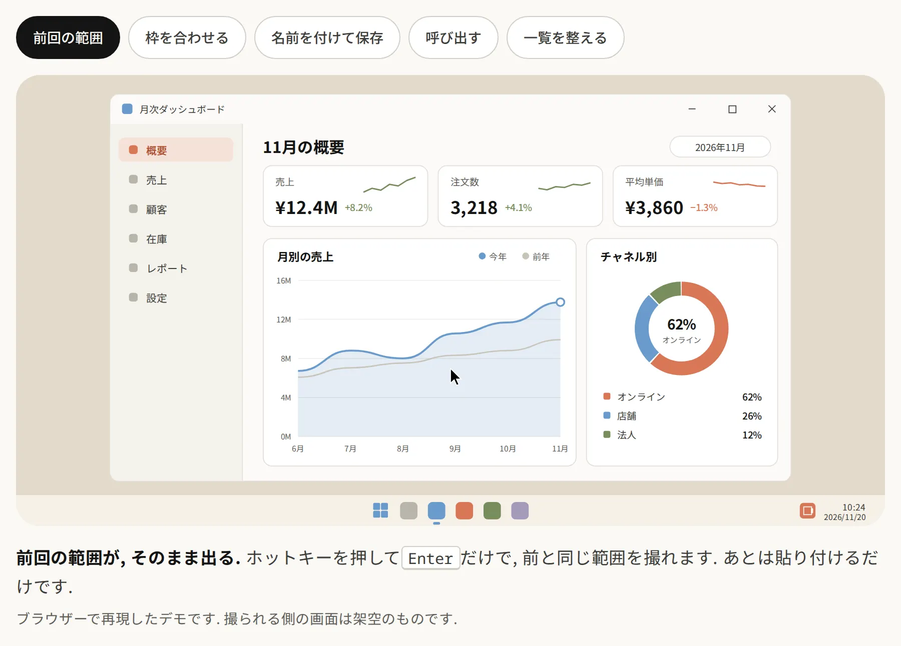

# Wakudori(枠撮り)

**撮る範囲を保存して, 何度でも同じ範囲で撮れる**Windows用のスクリーンショットツール.

<a href="https://maonthemoon.github.io/wakudori/">
  <picture>
    <source media="(max-width: 767px) and (prefers-color-scheme: dark)" srcset="docs/images/demo-narrow-dark.webp">
    <source media="(max-width: 767px)" srcset="docs/images/demo-narrow-light.webp">
    <source media="(prefers-color-scheme: dark)" srcset="docs/images/demo-dark.webp">
    
  </picture>
</a>

[紹介のページ](https://maonthemoon.github.io/wakudori/)では, 5つの場面をタブで選んで見られます.

Snipping Toolでは, 撮るたびに範囲をドラッグで選び直す必要があります. Wakudoriは前回の範囲を覚えていて, 範囲に名前を付けて保存もできます. 毎週のレポートのグラフ, 決まった画面の同じ部分など, 同じ範囲を繰り返し撮る作業に向いています.

## できること

- **前回の範囲がそのまま出る**: ホットキーを押して`Enter`を押すだけで, 前と同じ範囲を撮れます.
- **範囲に名前を付けて保存**: `Ctrl+S`で保存します. 保存した範囲は選択画面の上に並び, クリックか数字キー`1`〜`9`で呼び出せます. 名前に乗せると, 枠が動いて範囲を下見できます.
- **ドラッグで選び直す**: 枠の外をドラッグすると, その範囲が新しい枠になります. `F`でモニター全体も撮れます.
- **撮ってすぐ書き込む**: `E`で撮ると, ペンと塗りつぶし(隠す用)で書き込めます.
- **1px単位で調整**: 辺や角をドラッグするほか, 辺を選んで矢印キーで1pxずつ(`Ctrl`+矢印キーで10pxずつ)動かせます.
- **クリップボードとPNGの両方に出す**: 撮った画像はすぐ貼り付けられ, `ピクチャ\Screenshots`にもファイルで残ります.
- **軽い**: インストール不要のexe 1つで動きます. Windowsに標準で入っている.NET Framework 4.8だけで動き, 管理者権限も要りません.
- **表示スケールと複数モニターに対応**: 拡大率が100%でも150%でも, 範囲は画面のピクセルどおりに撮れます(拡大率の違うモニターを並べた環境は確認中).

## はじめかた

1. [Releases](https://github.com/maonthemoon/wakudori/releases)から`Wakudori-x.y.z.zip`をダウンロードし, 好きな場所(例: `ドキュメント\Wakudori`)に展開します.
2. `Wakudori.exe`を起動します. 署名していないので, 「WindowsによってPCが保護されました」と出たら「詳細情報」→「実行」を押します.
3. ホットキーの登録画面が出たら, 使うキー(例: `Ctrl+Shift+S`)を押して「登録」を押します. Wakudoriはタスクトレイに常駐します.
4. ホットキーを押すと選択画面が開きます. 枠を合わせて`Enter`で撮ります.

### gitを使う場合

cloneして, `bin\Wakudori.exe`を起動するだけで使えます(最新のリリースと同じexeです). gitで取ってきたファイルなら, SmartScreenの警告は出ない見込みです(実機では未確認).

```sh
git clone https://github.com/maonthemoon/wakudori.git
```

新しい版にするときは, トレイのメニューで「終了」してから`git pull`し, もう一度起動します(起動している間はexeを上書きできないため).

v0.1.0のころにcloneした人へ: exeはリポジトリの直下から`bin\Wakudori.exe`に移りました. `git pull`のあと`bin\Wakudori.exe`を一度起動すると, 「PC起動時に起動」の登録先も新しい場所に直ります.

### 自動起動とマニュアル

初めて起動したときに「PCの起動時に起動しますか」と聞かれます. あとからでも, トレイのメニューの「PC起動時に起動」で切り替えられます.

詳しい使い方は[マニュアル](https://maonthemoon.github.io/wakudori/manual.html)にあります(トレイのメニューの「マニュアル」からも開けます. exeと一緒に配られた`docs\manual.html`が開き, Webは見にいきません).

## 操作

### 選択画面

| 操作 | 動き |
|---|---|
| 辺・角をドラッグ | 大きさを変える(辺のどこでもつかめる) |
| 枠の内側をドラッグ | 枠全体を動かす(別のモニターへも移せる) |
| 枠の外をドラッグ | その範囲を新しい枠にする. 離しても撮らない(ドラッグ中に`Esc`で元の枠に戻る) |
| `Shift`+ドラッグ | 枠の中や辺の上からでも, 新しい枠を引く |
| 辺・角をクリック | その辺(角なら2辺)を選ぶ. 外側につまみが出る |
| 矢印キー | 選んだ辺を, 選んでいなければ枠全体を1px動かす. `Ctrl`+矢印キーは10px |
| `Enter` | 撮る |
| `E` | 撮って, 書き込む画面を開く |
| `F` / `Shift+F` | カーソルのあるモニター全体を撮る / 撮って書き込む(前回の範囲は変わらない) |
| `Space` | 止めた画面と動いている画面を切り替える |
| `Esc` | 辺の選択を外す. 選んでいなければ撮らずに閉じる |
| `Ctrl+S` | 今の枠に名前を付けて保存する |
| `1`〜`9` | 保存した範囲を呼び出す |

### 書き込み

`E`か`Shift+F`で撮ると, 撮ったのと同じ位置に画像が出ます.

| 操作 | 動き |
|---|---|
| ドラッグ | ペンで書く |
| `Shift`+ドラッグ | 四角く黒で塗りつぶす(隠す用) |
| パレットのクリック, `1`〜`7` | ペンの色を選ぶ(最初はオレンジ) |
| `Ctrl+Z` / `Ctrl+Y` | 元に戻す / やり直す |
| `Tab` | パレットを隠す, 出す |
| `Enter` | クリップボードに入れ, `<元の名前>_edit.png`で保存して閉じる |
| `Esc` | 書き込みを捨てて閉じる |

書き込む前の画像も, 保存フォルダーに残ります. 隠した部分がある画像を渡すときは, `_edit`の付いたほうを渡してください.

### 保存した範囲の一覧

選択画面の上に, 保存した範囲の名前が1行で並びます. 入りきらない分は「+N」にまとまり, カーソルを乗せると縦の一覧が開きます.

- **クリック**: その範囲を呼び出す. 動かさずに撮ると, ファイル名に範囲の名前が付きます.
- **カーソルを乗せる**: 枠がその範囲へ動いて下見できる. 離れると元に戻ります.
- **ダブルクリック**: その場で名前を変える.
- **ドラッグ**: 並べ替える. 数字キーの番号も並び順どおりになります.
- **右端の×**: 削除する(確認あり).

### タスクトレイ

アイコンのクリックで選択画面を開きます. 右クリックのメニューには, 撮影, ホットキー再登録, 画像保存フォルダーを開く, 設定フォルダーを開く, PC起動時に起動, マニュアル, 終了があります.

## 保存されるもの

| 場所 | 中身 |
|---|---|
| `ピクチャ\Screenshots\` | 撮った画像. `<範囲の名前>_yyyyMMdd_HHmmss.png`(名前のない範囲は`screenshot_...`) |
| `%APPDATA%\Wakudori\settings.json` | ホットキー(`hotkey`)と画像の保存先(`saveDir`) |
| `%APPDATA%\Wakudori\regions.json` | 保存した範囲と前回の範囲. 手で編集してもよい(選択画面を開くたびに読み直す) |

アンインストールは, トレイのメニューで「PC起動時に起動」を外して「終了」してから, `Wakudori.exe`のフォルダーと`%APPDATA%\Wakudori`を消すだけです.

## 動作環境

- Windows(Windows 11とWindows 10 22H2で動作を確認)
- .NET Framework 4.8(Windowsに標準で入っています)

## 開発者向け

### ビルド

SDKのインストールは不要です. Windows標準の`csc.exe`(.NET Framework 4.8)でビルドします.

1. このリポジトリをcloneするか, ZIPでダウンロードして展開します.
2. `build.cmd`をダブルクリックします.
3. `out\Wakudori.exe`ができます(`bin\Wakudori.exe`はリリースした版なので上書きしません).

C# 5の文法で書いています(`csc.exe`がC# 5までのため).

配る用のZIPは`powershell -ExecutionPolicy Bypass -File tools\package.ps1`で`dist\`に作ります. バージョンは`src/AssemblyInfo.cs`で決めます.

`v`で始まるタグ(例: `v0.1.0`)をpushすると, GitHub Actionsがビルドとテストを行い, ZIPをReleasesに置きます. あわせて, `bin\Wakudori.exe`をそのexeに差し替えて`main`にcommitします(`.github/workflows/build.yml`). `bin\Wakudori.exe`は手で更新しません.

### テスト

WinFormsに依存しない部分(枠の計算, ファイル名, ホットキーの文字列, `regions.json`の読み書き)のテストです. .NET 8 SDKがあれば, Windows以外でも動きます.

```sh
dotnet run --project tests/SelectionTests
dotnet run --project tests/OutputTests
dotnet run --project tests/HotkeyTests
dotnet run --project tests/RegionTests
```

### 画像の作り直し

- アイコン: `tools/make_icon.py`を直して`uv run tools/make_icon.py`で`app.ico`を作り直します. タスクトレイのアイコン(`src/Theme.cs`の`CreateAppIconHandle`)も同じ絵に直します.
- 紹介のページ: GitHub Pagesのトップ(`docs/index.html`)は, 選択画面をHTMLで作り直した動くデモのページです. `./tools/build-manual.sh`でマニュアル(`docs/manual.html`)と一緒に作ります(元のファイルは開発用の文書と一緒に置いていて, このリポジトリには入っていません). 選択画面の色や大きさを変えたら, 元のファイルもそろえます.
- READMEの動く画像: READMEではJavaScriptが動かないので, `uv run tools/make-demo.py`で, 紹介のページのデモを`docs/images/demo-*.webp`に書き出します(ライトとダーク, 広い幅と狭い幅の4枚. Playwrightのchromiumを使う). デモを変えたら作り直します.

## ライセンス

[MIT License](LICENSE)
