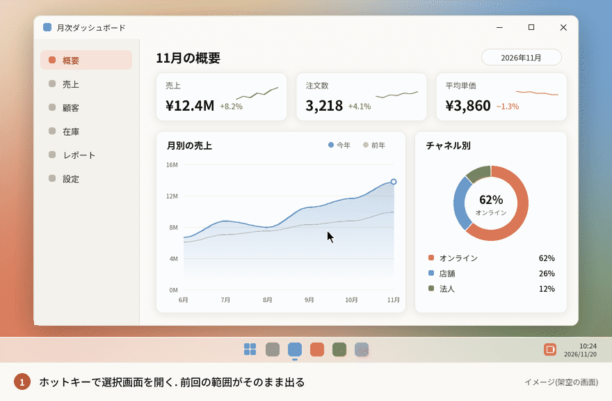

# Wakudori(枠撮り)

**撮る範囲を保存して, 何度でも同じ範囲で撮れる**Windows用のスクリーンショットツール.



<sub>画像はイメージです(架空の画面に, Wakudoriの選択画面を同じ色と大きさで描いたもの).</sub>

Snipping Toolでは, 撮るたびに範囲をドラッグで選び直す必要があります. Wakudoriは前回の範囲を覚えていて, 範囲に名前を付けて保存もできます. 毎週のレポートのグラフ, 決まった画面の同じ部分など, 同じ範囲を繰り返し撮る作業に向いています.

## できること

- **前回の範囲がそのまま出る**: ホットキーを押して`Enter`を押すだけで, 前と同じ範囲を撮れます.
- **範囲に名前を付けて保存**: `Ctrl+S`で保存します. 保存した範囲は選択画面の上に並び, クリックか数字キー`1`〜`9`で呼び出せます. 名前に乗せると, 枠が動いて範囲を下見できます.
- **1px単位で調整**: 辺や角をドラッグするほか, 辺を選んで矢印キーで1pxずつ(`Ctrl`+矢印キーで10pxずつ)動かせます.
- **クリップボードとPNGの両方に出す**: 撮った画像はすぐ貼り付けられ, `ピクチャ\Screenshots`にもファイルで残ります.
- **軽い**: インストール不要のexe 1つで動きます. Windowsに標準で入っている.NET Framework 4.8だけで動き, 管理者権限も要りません.
- **表示スケールと複数モニターに対応**: 拡大率が100%でも150%でも, 範囲は画面のピクセルどおりに撮れます(拡大率の違うモニターを並べた環境は確認中).

## はじめかた

1. [Releases](https://github.com/maonthemoon/wakudori/releases)から`Wakudori-x.y.z.zip`をダウンロードし, 好きな場所(例: `ドキュメント\Wakudori`)に展開します.
2. `Wakudori.exe`を起動します. 署名していないので, 「WindowsによってPCが保護されました」と出たら「詳細情報」→「実行」を押します.
3. ホットキーの登録画面が出たら, 使うキー(例: `Ctrl+Shift+S`)を押して「登録」を押します. Wakudoriはタスクトレイに常駐します.
4. ホットキーを押すと選択画面が開きます. 枠を合わせて`Enter`で撮ります.

初めて起動したときに「PCの起動時に起動しますか」と聞かれます. あとからでも, トレイのメニューの「PC起動時に起動」で切り替えられます.

詳しい使い方は[マニュアル](https://maonthemoon.github.io/wakudori/)にあります(ZIPの`manual\index.html`, トレイのメニューの「マニュアル」からも開けます).

## 操作

### 選択画面

| 操作 | 動き |
|---|---|
| 辺・角をドラッグ | 大きさを変える(辺のどこでもつかめる) |
| 枠の内側をドラッグ | 枠全体を動かす(別のモニターへも移せる) |
| 辺・角をクリック | その辺(角なら2辺)を選ぶ. 外側につまみが出る |
| 矢印キー | 選んだ辺を, 選んでいなければ枠全体を1px動かす. `Ctrl`+矢印キーは10px |
| `Enter` | 撮る |
| `Esc` | 辺の選択を外す. 選んでいなければ撮らずに閉じる |
| `Ctrl+S` | 今の枠に名前を付けて保存する |
| `1`〜`9` | 保存した範囲を呼び出す |

### 保存した範囲の一覧

選択画面の上に, 保存した範囲の名前が1行で並びます. 入りきらない分は「+N」にまとまり, カーソルを乗せると縦の一覧が開きます.

- **クリック**: その範囲を呼び出す. 動かさずに撮ると, ファイル名に範囲の名前が付きます.
- **カーソルを乗せる**: 枠がその範囲へ動いて下見できる. 離れると元に戻ります.
- **ダブルクリック**: その場で名前を変える.
- **ドラッグ**: 並べ替える. 数字キーの番号も並び順どおりになります.
- **右端の×**: 削除する(確認あり).

### タスクトレイ

アイコンのクリックで選択画面を開きます. 右クリックのメニューには, 撮影, ホットキー再登録, 画像保存フォルダーを開く, 設定フォルダーを開く, PC起動時に起動, マニュアル, 終了があります.

## 保存されるもの

| 場所 | 中身 |
|---|---|
| `ピクチャ\Screenshots\` | 撮った画像. `<範囲の名前>_yyyyMMdd_HHmmss.png`(名前のない範囲は`screenshot_...`) |
| `%APPDATA%\Wakudori\settings.json` | ホットキー(`hotkey`)と画像の保存先(`saveDir`) |
| `%APPDATA%\Wakudori\regions.json` | 保存した範囲と前回の範囲. 手で編集してもよい(選択画面を開くたびに読み直す) |

アンインストールは, トレイのメニューで「PC起動時に起動」を外して「終了」してから, `Wakudori.exe`のフォルダーと`%APPDATA%\Wakudori`を消すだけです.

## 動作環境

- Windows 11(Windows 10 22H2でも動作を確認)
- .NET Framework 4.8(Windowsに標準で入っています)

## 開発者向け

### ビルド

SDKのインストールは不要です. Windows標準の`csc.exe`(.NET Framework 4.8)でビルドします.

1. このリポジトリをcloneするか, ZIPでダウンロードして展開します.
2. `build.cmd`をダブルクリックします.
3. `bin\Wakudori.exe`ができます.

C# 5の文法で書いています(`csc.exe`がC# 5までのため).

配る用のZIPは`powershell -ExecutionPolicy Bypass -File tools\package.ps1`で`dist\`に作ります. バージョンは`src/AssemblyInfo.cs`で決めます.

`v`で始まるタグ(例: `v0.1.0`)をpushすると, GitHub Actionsがビルドとテストを行い, ZIPをReleasesに置きます(`.github/workflows/build.yml`).

### テスト

WinFormsに依存しない部分(枠の計算, ファイル名, ホットキーの文字列, `regions.json`の読み書き)のテストです. .NET 8 SDKがあれば, Windows以外でも動きます.

```sh
dotnet run --project tests/SelectionTests
dotnet run --project tests/OutputTests
dotnet run --project tests/HotkeyTests
dotnet run --project tests/RegionTests
```

### 画像の作り直し

- アイコン: `tools/make_icon.py`を直して`uv run tools/make_icon.py`で`app.ico`を作り直します. タスクトレイのアイコン(`src/Theme.cs`の`CreateAppIconHandle`)も同じ絵に直します.
- READMEの画像: `uv run tools/make_demo.py`で`docs/images/`に作り直します. 選択画面の色や大きさを変えたら, スクリプトの先頭の定数もそろえます.

## ライセンス

[MIT License](LICENSE)
